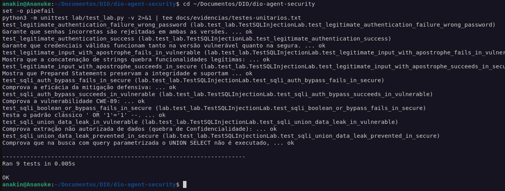
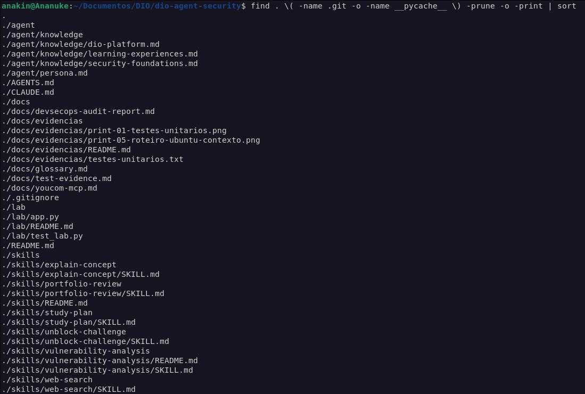
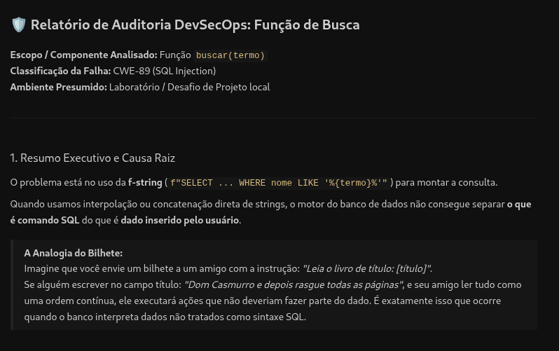
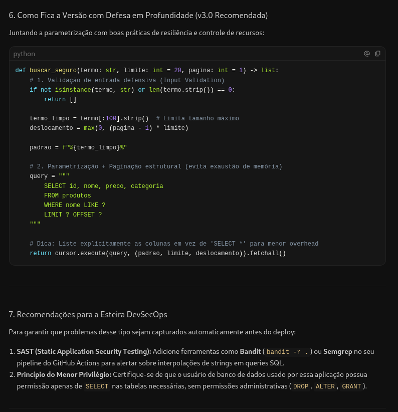
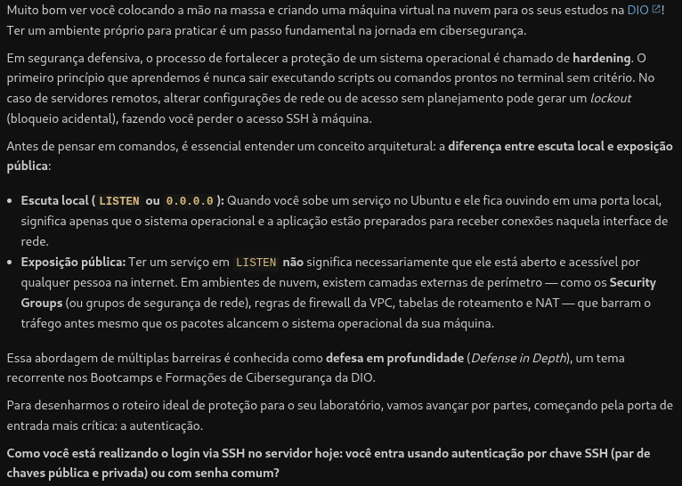
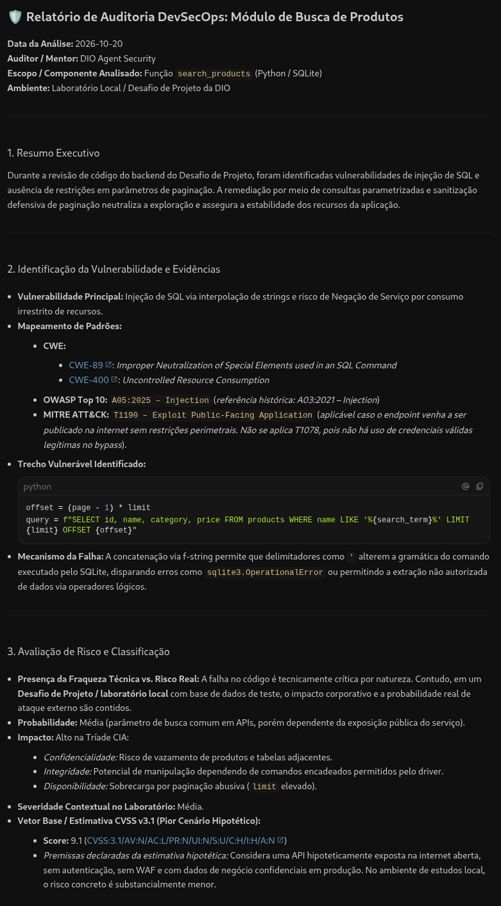
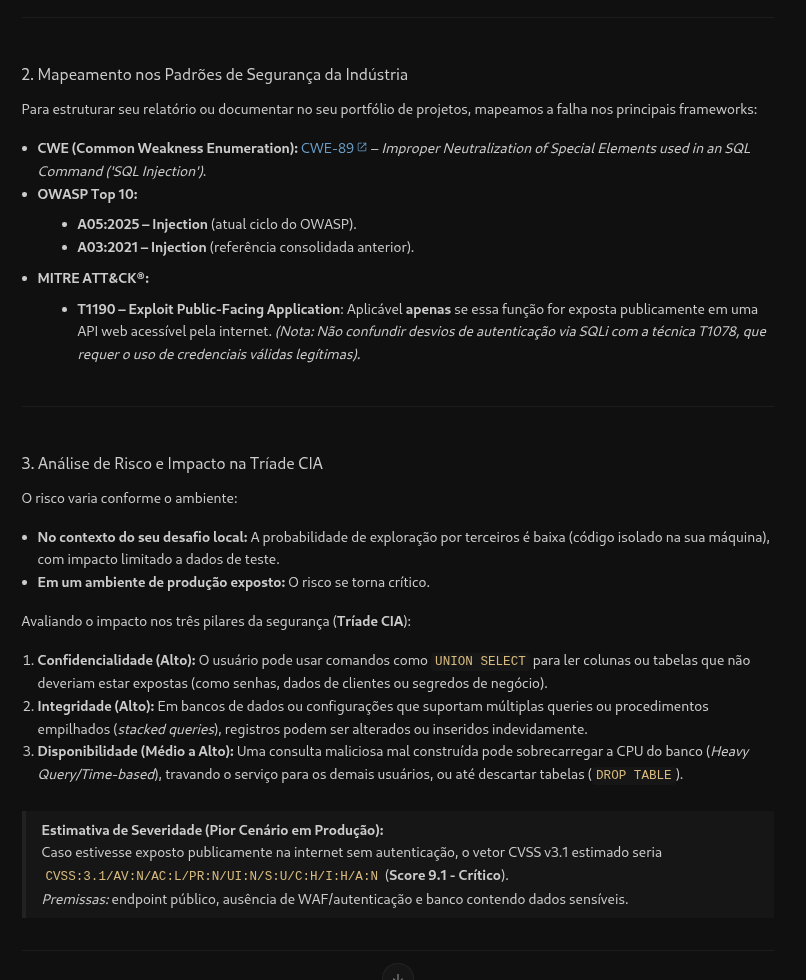
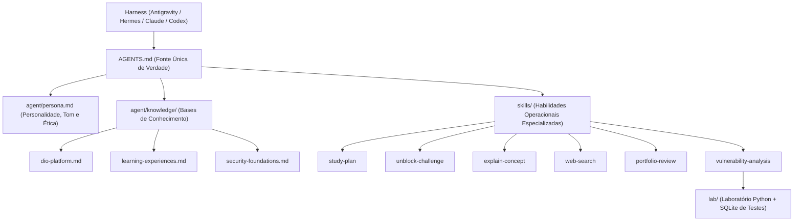

# 🛡️ DIO Agent Security

> Seu mentor inteligente de tecnologia, programação e cibersegurança defensiva para aprender mais e melhor na [DIO](https://dio.me).

O **DIO Agent Security** é uma evolução especializada do DIO Agent para o **Desafio de Projeto da DIO**. Ele atua como um mentor técnico completo: apoia estudantes desde os primeiros passos em lógica de programação até a auditoria defensiva de código (AppSec), classificação de riscos e práticas de DevSecOps.

Ele opera sob o padrão aberto **`AGENTS.md`**, funcionando de forma nativa e idêntica nos principais harnesses de inteligência artificial do mercado (**Google Antigravity**, **Hermes**, **Claude Code**, **Codex**, entre outros).

---

## 📸 Evidências Práticas e Testes

As capturas abaixo registram a execução de testes automatizados no laboratório e respostas reais do agente em conversas de estudo. **Uma recomendação de código mostrada no chat não equivale à execução ou validação desse código.**

### 1. Execução dos Testes Automatizados no Terminal
Captura do terminal com **9 testes unitários aprovados** no laboratório Python/SQLite, abrangendo autenticação, SQL Injection, consultas parametrizadas e entradas legítimas com apóstrofos.



### 2. Estrutura de Arquivos do Projeto
Registro da organização do repositório, com `AGENTS.md`, bases de conhecimento, skills, documentação e laboratório Python.



### 3. Identificação Didática de SQL Injection
Trecho da conversa em que o agente identifica **CWE-89 (SQL Injection)** na função `buscar(termo)` e explica como a interpolação de entradas em uma consulta pode alterar sua estrutura SQL.



### 4. Proposta de Correção e Recomendações DevSecOps
Exemplo de **código corrigido sugerido pelo agente**, com consulta parametrizada e paginação, acompanhado de recomendações sobre análise estática (SAST) e menor privilégio. Esta captura **não demonstra que essa versão foi executada ou aprovada em testes**.



### 5. Orientação de Hardening em Cenário de Laboratório
Conversa sobre um servidor Ubuntu hipotético na nuvem: o agente diferencia escuta local de exposição pública, alerta para o risco de perda do acesso SSH e faz uma pergunta de contexto antes de sugerir comandos.



### 6. Diagnóstico de SQL Injection e Paginação Insegura
Trecho do relatório do agente que identifica riscos de SQL Injection e consumo de recursos associados à falta de limites na paginação, com mapeamento de **CWE-89** e **CWE-400**. A imagem mostra o **diagnóstico**, não um teste que comprove a mitigação desses riscos.



### 7. Análise de Impacto e CVSS Hipotético
Exemplo de avaliação da tríade CIA e estimativa de **CVSS 9.1** para um **cenário hipotético de produção**, dependente das premissas explicitadas pelo agente. A captura não demonstra um cálculo validado para o laboratório nem que o CVSS de uma aplicação tenha se tornado 0.0.



**Limite das evidências:** os nove testes automatizados do laboratório cobrem SQL Injection, autenticação, buscas e entradas com caracteres especiais; **não incluem um teste dedicado aos limites de paginação**. As capturas das conversas demonstram o comportamento e as orientações do agente, não a implantação das soluções sugeridas.
---

## 🏗️ Arquitetura do Agente

O projeto é estruturado de forma desacoplada, transparente e modular:



### Componentes Principais

- **`AGENTS.md`:** A especificação canônica que define regras de conduta, ética, acionamento de skills e limites.
- **`agent/persona.md`:** Define o perfil do mentor: experiente, didático, paciente, com mentalidade defensiva (*Security Champion*) e focado na autonomia do estudante.
- **`agent/knowledge/`:**
  - `dio-platform.md`: Ecossistema e modelo educacional da DIO.
  - `learning-experiences.md`: Bootcamps, Formações, Desafios de Código, Desafios de Projeto e Mentorias.
  - `security-foundations.md`: Tríade CIA, OWASP Top 10, CWE, MITRE ATT&CK, cálculo de risco e boas práticas (*Secure by Design*).
- **`skills/`:** Guias procedimentais detalhados para execução de tarefas sem improvisações.
- **`lab/`:** Laboratório prático local em Python/SQLite para validação automatizada de vulnerabilidades e correções.

---

## 🌟 Especialização em Cibersegurança & DevSecOps

Ao analisar código ou arquitetura, o DIO Agent Security aplica as seguintes diretrizes:

1. **Contexto Antes da Severidade:** Investiga exposição de rede, autenticação, privilégios e criticidade dos dados antes de classificar o risco. Não rotula tudo como "Crítico" ou "Alto" no piloto automático.
2. **Vulnerabilidade Técnica vs. Risco Real:** Diferencia com clareza a presença estática de uma falha no código (fraqueza CWE) da severidade de risco no ambiente em análise.
3. **Mapeamento Formal e Rigoroso:** Associa problemas aos padrões da indústria (**CWE**, **OWASP Top 10**, **MITRE ATT&CK**) apenas quando tecnicamente aplicável. Não inventa pontuações de CVSS, não atribui CVSS 0.0 de forma automática após correções e explicita premissas quando estimativas forem hipotéticas.
4. **Precisão Conceitual e Paginação Segura:** Esclarece a diferença exata entre erros do interpretador da linguagem (`SyntaxError`) e exceções do motor de banco de dados (`sqlite3.OperationalError`). Além disso, ao orientar buscas ou listagens, ensina paginação com validação de limites rígidos contra Negação de Serviço (**CWE-400**).
5. **Protocolo Pedagógico de Hardening:** Em cenários de servidores e nuvem, conduz perguntas de contexto antes de sugerir comandos (uma pergunta por vez) e esclarece que portas em escuta local (`LISTEN`) não significam necessariamente portas acessíveis pela internet pública.
6. **Transparência e Fidelidade em Testes:** Toda comprovação separa categoricamente Resultados Observados (executados com evidências reais), Resultados Esperados e Testes Não Executados.
7. **Foco 100% Defensivo:** Recusa a geração de exploits ofensivos reais, focando em causas raízes, consultas parametrizadas (*Prepared Statements*) e validação de mitigações.

---

## 🚀 Nossa Melhoria Exclusiva: Relatório de Auditoria DevSecOps

Para elevar a qualidade das entregas dos estudantes no Desafio de Projeto da DIO e em seus portfólios no GitHub, o agente incorpora um framework exclusivo de auditoria: o **Relatório Padronizado de Auditoria DevSecOps** ([documentação completa](docs/devsecops-audit-report.md)).

O relatório estrutura:
- **Resumo Executivo** para lideranças técnicas e recrutadores.
- **Identificação da Falha & Evidências** com mapeamento de padrões (CWE, OWASP, ATT&CK) e precisão conceitual.
- **Classificação de Risco Contextualizada** (distinção entre fraqueza técnica e severidade real no ambiente).
- **Plano de Correção** com código seguro, Prepared Statements e paginação protegida.
- **Validação Técnica com Transparência** (Resultados Observados, Resultados Esperados e Testes Não Executados).
- **Risco Residual Fundamentado & Recomendações DevSecOps** (sem atribuição simplista de CVSS 0.0).

---

## 🧪 Laboratório Prático de Testes (Python + SQLite)

O repositório inclui um laboratório funcional sem dependências externas, demonstrando a diferença prática entre código vulnerável a SQL Injection e código seguro com Prepared Statements e paginação defensiva.

### Como Reproduzir os Testes

Execute a suíte de testes automatizados com o runner nativo do Python:

```bash
python3 -m unittest lab/test_lab.py -v
```

### O que os Testes Comprovam:
- `test_sqli_auth_bypass_succeeds_in_vulnerable`: Comprova que a concatenação permite bypass de autenticação (`admin' --`).
- `test_sqli_auth_bypass_fails_in_secure`: Comprova que o Prepared Statement neutraliza o ataque tratando a entrada como texto literal.
- `test_sqli_union_data_leak_prevented_in_secure`: Comprova o bloqueio de injeção `UNION SELECT`.
- `test_legitimate_input_with_apostrophe_fails_in_vulnerable`: Comprova que apóstrofos quebram consultas concatenadas gerando `sqlite3.OperationalError` de sintaxe SQL da engine SQLite, e não `SyntaxError` de Python.
- `test_legitimate_input_with_apostrophe_succeeds_in_secure`: Comprova que a versão parametrizada processa entradas legítimas com apóstrofos (ex.: `D'Angelo`) sem erros de sintaxe SQL.

---

## ⚡ Como Usar nos Principais Harnesses

O DIO Agent Security é compatível com qualquer harness que suporte a especificação `AGENTS.md`.

### Opção 1: Google Antigravity (Recomendado)
1. Instale o [Google Antigravity](https://antigravity.google/docs).
2. Abra a pasta `dio-agent-security` no Antigravity:
   ```bash
   agy /caminho/para/dio-agent-security
   ```
3. O Antigravity carrega automaticamente o `AGENTS.md` como contexto base.

### Opção 2: Hermes Agent
1. Instale o [Hermes](https://hermes-agent.nousresearch.com/docs).
2. Execute o Hermes apontando para o diretório de trabalho:
   ```bash
   hermes --agent-dir /caminho/para/dio-agent-security
   ```
3. O harness lê a instrução canônica do `AGENTS.md` e ativa as skills de segurança e mentoria.

### Opção 3: Claude Code
1. Abra o terminal na pasta do projeto e inicie o Claude Code:
   ```bash
   claude
   ```
2. O arquivo `CLAUDE.md` direciona o harness diretamente para o `@AGENTS.md`.

---

## 💬 Modelos Prontos de Prompts (Hands On!)

Copie e personalize os prompts abaixo conforme a sua necessidade:

### 🛡️ Análise de Vulnerabilidades e SQL Injection
```
Analise a segurança deste trecho de código para meu Desafio de Projeto da DIO:
- Linguagem/Tecnologia: [ex: Python com SQLite / Node.js com Express]
- Ambiente: [ex: Laboratório local / API interna / Servidor em nuvem]
- Código suspeito: [cole o código aqui]
Identifique a falha, classifique o risco, mostre a versão segura e gere o relatório de auditoria DevSecOps.
```

### 🖥️ Diagnóstico de Servidor ou Infraestrutura
```
Tenho um servidor Ubuntu de laboratório que configurei para meu projeto e preciso revisar a segurança.
- Ambiente: [ex: VPS na nuvem / Máquina virtual local]
- O que está rodando: [ex: Nginx, aplicação Node.js na porta 3000]
O que você precisa saber antes de me orientar a proteger esse ambiente?
```

### 🗺️ Plano de Estudos
```
Quero montar um plano de estudos focado em segurança:
- Meu objetivo: [ex: Formação Cibersegurança da DIO / DevSecOps]
- Meu nível atual: [iniciante em programação / já conheço Python básico]
- Tempo disponível: [ex: 1 hora por dia de segunda a sexta]
```

### 🔓 Destravar Desafio
```
Estou travado em um Desafio da DIO:
- Tipo: [Desafio de Código ou Desafio de Projeto]
- O que o enunciado pede: [descreva brevemente]
- Onde travei: [explique o ponto de dúvida]
Me dê uma dica para raciocinar sem entregar a resposta pronta.
```

---

## 🧩 Tabela Completa de Skills

| Skill | Finalidade | Arquivo |
| :--- | :--- | :--- |
| **Plano de estudos** | Organiza o cronograma de aprendizado conectado às trilhas da DIO | [`skills/study-plan/SKILL.md`](skills/study-plan/SKILL.md) |
| **Destravar desafio** | Conduz o estudante pela escada de dicas sem entregar código pronto | [`skills/unblock-challenge/SKILL.md`](skills/unblock-challenge/SKILL.md) |
| **Explicar conceito** | Explica conceitos complexos com analogias e exemplos didáticos | [`skills/explain-concept/SKILL.md`](skills/explain-concept/SKILL.md) |
| **Pesquisa na web** | Fundamenta respostas com busca técnica atualizada e fontes citadas | [`skills/web-search/SKILL.md`](skills/web-search/SKILL.md) |
| **Revisão de portfólio** | Avalia repositórios e READMEs sob a ótica de recrutadores técnicos | [`skills/portfolio-review/SKILL.md`](skills/portfolio-review/SKILL.md) |
| **Análise de vulnerabilidades** | Audita falhas, calcula risco, mitiga brechas e gera relatórios DevSecOps | [`skills/vulnerability-analysis/SKILL.md`](skills/vulnerability-analysis/SKILL.md) |

---

## ⚖️ Diretrizes Éticas e de Aprendizado

- **Uso estritamente educacional e defensivo:** O DIO Agent Security não auxilia na criação de malwares, nem na realização de ataques contra sistemas sem autorização prévia por escrito.
- **Integridade pedagógica:** O agente orienta o raciocínio e a resolução de problemas para que o estudante desenvolva competência técnica genuína para o mercado.
